<p align="center"></p>

# Football Manager 27 Editor

[English](README.md) | Tiếng Việt

Editor dùng khi đang chơi Football Manager 27. App sửa cầu thủ, nhân sự, CLB, quốc gia và nhiều thứ khác ngay lúc game
đang chạy, bằng cách đọc và ghi bộ nhớ của `fm.exe` (module `game_plugin.dll`). Làm cho bản Xbox / Game Pass và Steam;
xem phần [Yêu cầu](#yêu-cầu) để biết đã kiểm trên bản nào.

Chỉ dùng cho save chơi một mình, offline. Không dùng khi chơi online hay với save chung.

## App làm được gì

| Mục | Sửa được |
|---|---|
| Cầu thủ | Chỉ số, vị trí, tính cách, CA/PA, danh tiếng, chiều cao, ngày sinh, quốc tịch và thông tin khác; hợp đồng và hợp đồng tương lai, thưởng và điều khoản chuyển nhượng; kế hoạch sự nghiệp, quan hệ, ngôn ngữ, động tác ưa thích; chấn thương, án treo giò, bất mãn, triệu tập đội tuyển; giấy phép lao động và lời hứa |
| Chuyển cầu thủ | Chuyển CLB dưới dạng chuyển nhượng (có phí và % bán lại), cho mượn, hoặc **chuyển nhượng tương lai** có ngày và đủ điều khoản (trả góp, tiền theo số trận và bàn thắng, phí mua lại, bán lại, đóng góp lương, giao hữu); đổi chỗ hai cầu thủ; giải phóng hợp đồng; đội trưởng / đội phó; chép chỉ số sang cầu thủ khác; so sánh |
| Nhân sự | Chỉ số, CA/PA, tính cách, training rating, số trận và bàn thắng quốc tế, bằng huấn luyện, điểm vai trò, hợp đồng, kế hoạch sự nghiệp, quan hệ, ngôn ngữ, hiểu biết, sơ đồ, xu hướng, chuyển sang CLB khác kèm vai trò và lương mới |
| CLB | Thông tin, tài chính, nợ, CLB liên kết, tầm nhìn CLB, áo đấu và màu, quan hệ, nhân sự, đội hình, trung tâm chuyển nhượng |
| Quốc gia, sân, thành phố, giải đấu, giải thưởng, trọng tài, loại chấn thương | Thông tin, danh tiếng và thiết lập, mỗi loại một màn riêng. Sân: chủ sở hữu, vị trí, sân lân cận và toạ độ. Thành phố: quốc gia, vùng, ngôn ngữ và khí hậu |
| Công cụ | Preset cả đội có xem trước và Undo (hồi phục, thể lực, tinh thần, xoá án treo giò, xoá bất mãn, chỉ số tối đa, chặn giải nghệ, tactical understanding, team cohesion), Mass Edit, Hook Manager (Wonderkid Academy, Development Speed), khoá giá trị, xuất CSV / JSON, bộ lọc nâng cao, yêu thích, tải lại màn hình hiện tại (Ctrl+R) |

Mọi thay đổi được ghi vào lịch sử, có Undo. Xem [CHANGELOG.md](CHANGELOG.md) để biết bản mới có gì.

Đọc toàn bộ cầu thủ trong dữ liệu game (khoảng 50.000 người) mất chưa tới 1 giây.

Trước mỗi lần ghi, app kiểm tra:
- object ở địa chỉ đó vẫn đúng như app đã đọc;
- giá trị trong bộ nhớ vẫn bằng giá trị app đã đọc.

Sau khi ghi, app đọc lại để xác nhận. Nếu có gì không khớp thì app không ghi gì cả và báo lỗi.

Một vài thao tác thêm dòng vào danh sách của game (lời hứa mới, chuyển nhượng tương lai, ngôn ngữ). Khi danh sách đầy,
app cấp một danh sách mới ngoài bộ cấp phát của game. Hãy sao lưu save trước khi dùng chúng.

## Điểm nổi bật

### Mass Edit
Sửa hàng trăm cầu thủ, HLV, CLB hay quốc gia trong một lần. Chọn những ai bị ảnh hưởng bằng chính bộ lọc của Advanced
Search. Sau đó, với mỗi trường, chọn **Set to** (ai cũng nhận giá trị này) hoặc **Change by** (ai cũng tăng hoặc giảm một
lượng). Trước khi ghi, bạn có danh sách xem lại từng người, từng trường, giá trị cũ → mới, và bỏ tick được chỗ không
muốn. Cả lượt sửa nằm trong lịch sử thành một mục. Bạn có thể hoàn tác cả lượt, từng người, hoặc từng trường.

### Training Rating của HLV
FM không lưu số sao huấn luyện của HLV mà tính ra từ chỉ số của ông ấy. Editor tính đúng như vậy, nên số sao khớp với
game. Mỗi mảng trong 11 mảng kết hợp chỉ số chuyên môn của HLV với **Determination**, **Authority** và **Motivating**
(mỗi chỉ số tính hai lần):

| Mảng | Chỉ số nặng ký nhất |
|---|---|
| Thủ môn: Shot Stopping | Goalkeeping (×9) |
| Thủ môn: Handling and Distribution | Goalkeeping (×6), nên tối đa 4 sao |
| Phòng ngự, Tấn công (Technical / Tactical) | Defending hoặc Attacking (×6) cộng Technical hoặc Tactical (×3) |
| Kiểm soát bóng (Technical / Tactical) | Possession (×3) cộng Technical hoặc Tactical (×6) |
| Sức mạnh, Tốc độ | Fitness (×9) |
| Bóng chết | Set Pieces (×3) cộng Tactical Knowledge (×6) |

Tổng có trọng số được đổi ra 0–5 sao, bước nửa sao.

Muốn đổi một mảng, kéo thanh trượt của mảng đó. Khi Save, mọi chỉ số đứng sau mảng đó thành **số sao × 4** trên thang
1–20 (4 sao → 16). Determination, Authority và Motivating có mặt ở mọi mảng, nên các mảng khác cũng đổi theo. Trong Mass
Edit, "Change by" cộng vào số sao hiện tại của từng HLV, giữ trong khoảng 0–5.

### Wonderkid Academy (Experimental)
Định hình các cầu thủ trẻ game tạo ra từ giờ trở đi (youth intake và cầu thủ mới).

- Mỗi cầu thủ trẻ mới nhận potential ngẫu nhiên trong khoảng bạn chọn, không thấp hơn CA hiện tại và không quá 200.
- **Wonderkid %** là khả năng cầu thủ đó còn có CA ban đầu cao hơn, tiến một phần về phía potential.
- Có thể áp cho mọi cầu thủ trẻ, hoặc chỉ cho cầu thủ của những châu lục, quốc gia hay CLB bạn chọn. Mỗi lúc chỉ một
  cấp có hiệu lực; chọn cấp rộng hơn sẽ bỏ các mục hẹp hơn mà nó đã bao.
- Cầu thủ đã có không bao giờ bị đổi.
- Tính năng chạy tới khi bạn tắt FM. Cửa sổ **How to use** hướng dẫn từng bước.

### Development Speed
Cho các cầu thủ được chọn tiến bộ nhanh hơn khi tập luyện: 2 là gấp đôi, 1 là bình thường, tối đa 20. Đặt ở thẻ Tools
của cầu thủ; Hook Manager liệt kê mọi cầu thủ đã được đặt.

### Thông tin nhân sự
Trang Information của nhân sự hiện và sửa được số trận và bàn thắng quốc tế, bằng huấn luyện (kể cả "Đang học…") và
điểm 15 vai trò (Manager, Coach, Scout, Data Analyst…).

### CLB
Sửa được ở màn CLB và trong Mass Edit:
- Status: Chuyên nghiệp, Bán chuyên hoặc Nghiệp dư.
- Đủ mọi lựa chọn Ownership, Chairperson Title và Rich Benefactor.
- Sức chứa và kích thước sân.

### Đội trưởng và thay đổi chưa lưu
**Make Captain** và **Make Vice Captain** chỉ cần một lần bấm. Mỗi tab con của cầu thủ hay HLV có dấu * khi còn thay
đổi chưa lưu, để bạn luôn biết mình đã sửa ở đâu.

### Tiền tệ
Tiền của CLB (số dư, ngân sách, lương và các mục tài chính khác) hiện theo đơn vị FM đang dùng (tự nhận ra), hoặc theo
đơn vị bạn chọn trong Settings. Đơn vị bạn tự chọn được giữ nguyên, kể cả khi game dùng đơn vị khác. Số bạn gõ vào được
quy đổi theo tỷ giá cố định của game trước khi lưu; game luôn lưu bằng bảng Anh, nên xem bằng đơn vị khác không làm
thay đổi gì trong save.

### Hiệu chuẩn
Mỗi bản game được hỗ trợ đều được kiểm với một save hiệu chuẩn: khoảng 550 giá trị đã biết, đọc từ FMRTE và màn hình
của FM, gồm chỉ số, hợp đồng, điều khoản, tài chính CLB, sân, quốc gia và HLV. Sau mỗi bản vá game, chỉ vài giây là
biết có gì bị lệch, trước khi giá trị sai kịp vào save của bạn.

## Yêu cầu

- Windows 10/11 x64
- Football Manager 27: Steam `27.0.1+2503222`, Xbox / Game Pass `27.0.1+2494687` (các bản cũ hơn ở bảng dưới vẫn chạy). Bản game khác cần profile offset mới, xem
  [Khi game có patch](#khi-game-có-patch).
- [.NET 10 SDK](https://dotnet.microsoft.com/download), chỉ khi bạn tự build

Đã kiểm trên bản nào:

| Bản | Tình trạng |
|---|---|
| Steam `27.0.1+2503222` | Bản Steam hiện tại. Mọi phần đọc (71 tính năng) và mọi loại ghi đã chạy trên game thật; 550 giá trị đối chiếu với save hiệu chuẩn, FMRTE và màn hình của FM |
| Xbox / Game Pass `27.0.1+2494687` | Bản Game Pass hiện tại. Mọi phần đọc và mọi loại ghi đã chạy trên game thật; qua cùng bộ kiểm hiệu chuẩn |
| Steam `27.0.1+2494687` | Bản Steam trước, vẫn hỗ trợ |
| Xbox / Game Pass và Steam `27.0.0+2493426` | Bản trước, vẫn hỗ trợ |
| Steam `27.0.0+2486695` | Bản cũ, dùng cho test |

## Tải về

Tải ở [Releases](../../releases):

| File | Dùng để |
|---|---|
| **`Fm27Editor.exe`** | App editor. Đa số người dùng chỉ cần file này. |
| `Fm27Editor.Tools.exe` | Công cụ dòng lệnh (xem bên dưới), có `find-offsets` cho bản game mới |

Mỗi file exe chạy độc lập từ thư mục nào cũng được. Không cần cài đặt, kể cả .NET.

Toàn bộ mã nguồn nằm trong repo này, và mỗi bản phát hành được build từ đó bằng [Build workflow](.github/workflows/build.yml)
trên máy chủ của GitHub. Không có gì build trên máy cá nhân hay upload bằng tay. Mỗi bản phát hành ghi rõ commit đã dùng,
và bạn kiểm tra được bằng hai cách:

- `SHA256SUMS.txt` trong bản phát hành có hash của từng file. So với `Get-FileHash Fm27Editor.exe`.
- Mỗi file có chứng thực build có chữ ký, nối file với lần chạy workflow và commit. Với
  [GitHub CLI](https://cli.github.com):

  ```bash
  gh attestation verify Fm27Editor.exe --repo Jackhamerp24/Football-Manager-27-Editor
  ```

App làm gì với máy của bạn: mở process `fm.exe`, đọc bộ nhớ, và ghi đúng những giá trị bạn sửa. Yêu cầu mạng duy nhất của app là một lần kiểm tra khi mở xem GitHub có bản mới hơn không (không gửi gì ngoài
chính yêu cầu đó; không có mạng thì bỏ qua âm thầm). App không đòi quyền quản trị. File duy nhất nó ghi là cài đặt của chính nó (`%LOCALAPPDATA%\Fm27Editor`: giá trị khoá, bộ lọc
đã lưu, thư mục đồ hoạ; `favorites.json` cạnh file exe) và các file xuất do bạn yêu cầu.

## Build và chạy

```bash
dotnet build Fm27Editor.slnx -c Release
```

```bash
dotnet test Fm27Editor.slnx -c Release
```

Mở FM27, nạp một save, rồi chạy app:

```bash
src/Fm27Editor.App/bin/Release/net10.0/Fm27Editor.exe
```

Hãy lưu game trước khi sửa. Game chỉ vẽ lại màn hình sau khi bạn bấm **Continue**, dù thay đổi đã nằm trong bộ nhớ.

## Công cụ dòng lệnh

Chạy khi game đang mở và đã nạp save.

```bash
src/Fm27Editor.Tools/bin/Release/net10.0/Fm27Editor.Tools.exe players Yamal
```

```bash
src/Fm27Editor.Tools/bin/Release/net10.0/Fm27Editor.Tools.exe set "Kobbie Mainoo" Crossing 12
```

```bash
src/Fm27Editor.Tools/bin/Release/net10.0/Fm27Editor.Tools.exe verify tests/golden/27.0.0+2486695.players.json
```

| Lệnh | Làm gì |
|---|---|
| `players [tên]` | Liệt kê cầu thủ khớp: ngày trong game, tuổi, CLB, lương, ngày hết hạn hợp đồng, CA/PA |
| `set <tên> <trường> <giá trị>` | Ghi một giá trị. Trường là chỉ số (`Pace`), vị trí (`Striker`), tính cách (`Ambition`), `CA` hoặc `PA` |
| `verify <golden.json>` | So bộ nhớ đang chạy với giá trị chép từ giao diện game |
| `find-offsets <golden.json> <out.json> [--date yyyy-MM-dd]` | Dựng lại profile offset cho bản game mới |

Còn nhiều lệnh khác (nhân sự, CLB, quốc gia, preset, lời hứa, chuyển nhượng, chuyển nhượng tương lai) được liệt kê ở đầu
`src/Fm27Editor.Tools/Program.cs`. Lệnh ghi cần `--write`; không có thì chỉ in kế hoạch.

## Năng lực trong FM hoạt động thế nào

CA là giá trị game coi là chuẩn. Qua vài ngày trong game, các chỉ số tự trôi về mức hợp với CA của cầu thủ, theo cả hai
hướng. Vì vậy tăng chỉ số mà không tăng CA có thể không giữ được; hãy sửa cả CA.

## Cấu trúc

| Đường dẫn | Nội dung |
|---|---|
| `src/Fm27Editor.Core` | Bộ nhớ process, kiểm tra build, profile offset, đọc dữ liệu, ghi có kiểm tra, công cụ dò offset |
| `src/Fm27Editor.App` | App desktop (Avalonia) |
| `src/Fm27Editor.Tools` | Công cụ dòng lệnh |
| `offsets/<build>.json` | Mọi địa chỉ và offset phụ thuộc bản game, mỗi bản một file. Được nhúng vào exe |
| `tests/Fm27Editor.Core.Tests`, `tests/Fm27Editor.App.Tests` | Unit test trên không gian địa chỉ giả |
| `tests/golden/<build>.players.json` | Giá trị cầu thủ chép từ giao diện game: chuẩn tham chiếu cho `verify` và `find-offsets` |
| `re/tools/memscan` | Công cụ quét bộ nhớ chỉ đọc, dùng để tìm cấu trúc của FM27 |

## Khi game có patch

App không gắn vào bản game mà nó chưa có profile. Điều này tránh ghi nhầm địa chỉ.

Để tạo profile cho bản mới:

1. Nạp một save. Chép đúng chỉ số, chiều cao và ngày sinh của vài cầu thủ vào một file golden mới.
   - Ít nhất một cầu thủ có tên thường gọi, và ít nhất một người không có.
   - Bỏ qua các khoảng do scout đoán như `9-12`.
2. Chạy `find-offsets <golden.json> offsets/<build>.json --date <ngày trong game>`. Mất khoảng 25 giây.
   Profile trong thư mục `offsets` cạnh file exe được dùng thêm vào các profile có sẵn, và thay profile có sẵn của cùng bản.
3. Chạy `verify` với cùng file golden.

`find-offsets` chỉ tìm cấu trúc cầu thủ. Các màn khác cần offset riêng; dựng lại toàn bộ profile bằng một lệnh nằm trong
lộ trình. Với Xbox / Game Pass, `re/tools/gamepass-rva-map.ps1` dựng profile từ profile Steam bằng cách khớp tên class
(RTTI), trong vài giây.

## Chưa hỗ trợ: bóng đá nữ

Editor được xây dựng và kiểm tra cho bóng đá nam. Đội, cầu thủ và giải đấu nữ chưa được hỗ trợ: có thể thiếu trong danh
sách, hiện không có nhãn hoặc sai dữ liệu, và việc sửa chúng chưa được thử, nên tránh ghi vào đó. Có thể bổ sung hỗ trợ bóng
đá nữ sau này; chưa có kế hoạch cho bản phát hành cụ thể nào.

## Lộ trình

Đã xong:

- Xbox / Game Pass và Steam, mỗi bản một profile.
- Cầu thủ, nhân sự, CLB, quốc gia, sân, thành phố, giải đấu, giải thưởng, trọng tài và loại chấn thương, mỗi loại một màn.
- Chuyển CLB: chuyển nhượng, cho mượn và chuyển nhượng tương lai với đủ điều khoản; đổi chỗ cầu thủ.
- Lời hứa (mọi loại), giấy phép lao động, preset tactical understanding cho cầu thủ và đội hình, yêu thích, tải lại màn
  hình hiện tại.
- Preset đội hình, khoá giá trị, xuất file, tìm kiếm nâng cao, xuất / nhập chỉ số.
- Giao diện sáng (trắng và xanh dương) bên cạnh giao diện tối, đổi bằng một nút và được nhớ cho lần sau.
- Sửa hàng loạt (mass edit) cho cầu thủ, nhân sự và CLB theo bố cục FMRTE, thêm phạm vi **Quốc gia** (Youth Rating và
  các field quốc gia) mà FMRTE không có; mở bằng nút trên thanh công cụ hoặc Ctrl+M.
- Training rating của HLV, bằng huấn luyện và điểm vai trò của nhân sự, Status của CLB; Wonderkid Academy và Development
  Speed; tiền theo đơn vị của game hoặc đơn vị bạn chọn; save hiệu chuẩn kiểm mọi bản game.
- Áo đấu và màu CLB, tài chính và nhà tài trợ; VAR, tiền thưởng, quy định đội hình và bảng xếp hạng của giải; thoả thuận,
  ưu tiên chuyển nhượng và EuroCoefficients của quốc gia; chủ sở hữu, vị trí, sân lân cận và toạ độ của sân; quốc gia,
  vùng, ngôn ngữ và khí hậu của thành phố.

Tiếp theo:

- Bản build cho macOS.
- Phân tích chuyên sâu: tab thông số radar và visualisation của cầu thủ.
- Danh sách theo dõi (shortlist).
- Điều khoản chuyển nhượng cho lần chuyển diễn ra ngay (hiện chỉ hỗ trợ % bán lại).
- Tab Scout Information và Stats; Possible Signings.
- Item áo đấu: đổi loại, thêm, xoá, nhân bản.
- Lịch tập.
- Phụ cấp huấn luyện viên (coach allowances).
- File exe nhỏ hơn, khởi động nhanh hơn.
- Bóng đá nữ (đội, cầu thủ, giải đấu), có thể làm sau.

## Tuyên bố miễn trừ

Dự án này không liên kết hay được bảo trợ bởi Sports Interactive hoặc SEGA. Football Manager là nhãn hiệu của họ. Sửa bộ
nhớ game có thể làm hỏng save, vì vậy hãy sao lưu. Tự chịu rủi ro khi dùng.

**Không bảo hành, không chịu trách nhiệm.** Editor thay đổi một game đang chạy theo cách nhà sản xuất không thiết kế sẵn. Phần
mềm được cung cấp "nguyên trạng": tác giả không chịu trách nhiệm cho save bị hỏng hoặc mất, game bị crash hay bất kỳ thiệt hại
nào khác do việc sử dụng. Hãy sao lưu save trước mỗi phiên chơi, và dùng save thử cho mọi thao tác bạn chưa chắc.

**Nếu save bị hỏng, hãy báo cho tác giả nguyên nhân.** Báo cáo của bạn giúp sửa lỗi cho tất cả mọi người. Bấm biểu tượng con
bọ ở góc dưới bên phải của editor, mô tả bạn đã làm gì rồi tạo báo cáo. Đó là một file zip lưu trên Desktop, gồm mô tả của
bạn, trạng thái editor và game, và nhật ký mọi lần editor ghi vào game (địa chỉ, byte cũ và mới) của mười lần chạy gần nhất.
Làm được cả khi editor còn mở lẫn sau khi bạn đã đóng editor hoặc game, vì nhật ký được lưu trên đĩa
(`%LOCALAPPDATA%\Fm27Editor\logs`). Không có gì được tải lên và không kèm file save; bạn tự gửi file zip, hoặc mở một
[issue](https://github.com/Jackhamerp24/Football-Manager-27-Editor/issues) (kéo thả file zip và ảnh chụp màn hình vào ô nội
dung; issue là công khai), hoặc gửi email tới vuquyduong2004@gmail.com (đính kèm file zip và ảnh). Hãy nói bạn dùng bản nào
(Game Pass hay Steam), bạn đã làm gì, và save còn mở được không. Đường dẫn thư mục trong nhật ký được cắt còn tên cuối
(`D:\Ảnh\Tôi\FM Graphics` thành `…\FM Graphics`), nhưng hãy xem lại file zip và ảnh trước khi gửi.

## Ủng hộ

Nếu editor giúp ích cho bạn, bạn có thể ủng hộ để dự án tiếp tục:

- [Ko-fi](https://ko-fi.com/quyduongvu) (thẻ hoặc PayPal)
- Chuyển khoản ngân hàng Việt Nam (VietQR, Vietcombank): quét bằng app ngân hàng hoặc ví điện tử bất kỳ


## Giấy phép

GPL-3.0-or-later. Xem [LICENSE](LICENSE).
